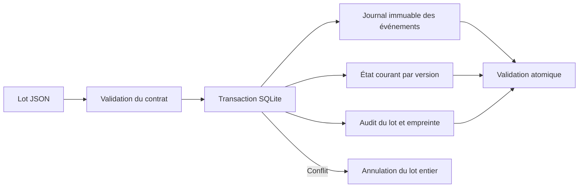

# Incremental Order Ledger

**Rejouer un import sans compter deux fois les commandes.** Un pipeline de data engineering local qui traite des événements versionnés, conserve leur historique et maintient un état métier cohérent dans SQLite.

Python standard uniquement · commandes fictives · pas de service externe · transactions et contrôles reproductibles.

## Problème métier

Un export de commandes peut être renvoyé après une interruption. Des corrections peuvent arriver dans le désordre. Une suppression déjà reçue ne doit pas disparaître au passage d'une ancienne version. Une erreur en fin de fichier ne doit pas laisser la moitié des lignes appliquées.

Ce projet traite ces cas avec des identifiants stables, des versions par commande, un journal d'événements et une transaction par lot. Il concerne la **fiabilité des mises à jour incrémentales**, au-delà de la validation de champs d'un fichier.



## Démonstration rapide

Python 3.10+ ; testé avec Python 3.14.3 sous Windows.

```sh
git clone https://github.com/abdelouahabmoulinepro-coder/incremental-order-ledger.git
cd incremental-order-ledger
python demo.py --output build/demo
python -m unittest discover -s tests -v
```

La démo utilise une base temporaire neuve à chaque exécution, puis conserve un rapport et les résultats JSON. Lire `build/demo/report.md` ou [le rapport publié](example/report.md).

### Résultat effectivement vérifié

| Étape | État observé |
|---|---|
| Import initial | A et B confirmées, C annulée : total confirmé **300 €** |
| Corrections et suppression | A corrigée, B supprimée, C confirmée, D créée : **215 €** |
| Même lot rejoué | État et compteurs persistés identiques : **215 €** |
| Ancienne version de B reçue en retard | B reste supprimée : **215 €** |
| Lot contenant E puis un conflit de version | Lot annulé intégralement ; E absente : **215 €** |

État final : **9 événements uniques, 3 lots validés, 3 commandes confirmées, 1 suppression logique**. Les montants sont fictifs ; il s'agit de l'état courant des commandes, pas d'un journal de paiements ni d'une comptabilité de chiffre d'affaires.

## Utilisation avec une base persistante

Choisir une base dédiée neuve pour reproduire exactement cette séquence :

```sh
python ledger.py --db build/orders.sqlite ingest data/01_initial.json
python ledger.py --db build/orders.sqlite ingest data/02_changes.json
python ledger.py --db build/orders.sqlite ingest data/02_changes.json
python ledger.py --db build/orders.sqlite ingest data/03_late_event.json
python ledger.py --db build/orders.sqlite snapshot
```

Pour vérifier volontairement le rejet d'un lot :

```sh
python ledger.py --db build/orders.sqlite ingest data/04_conflict.json
```

Cette dernière commande doit échouer avec le code **1**. Une nouvelle lecture `snapshot` conserve le même état. Le code 0 indique un succès ; 2 est le code standard de syntaxe invalide. Les erreurs d'ingestion sont explicites et ne sont pas transformées en succès.

## Règles de cohérence

| Situation | Comportement |
|---|---|
| Même `batch_id`, même contenu | Aucun nouvel effet ; réponse historique avec `replayed=true` |
| Même `batch_id`, contenu différent | Rejet intégral |
| Même `event_id`, même contenu | Doublon ignoré, dans un lot ou entre lots |
| Même `event_id`, contenu différent | Rejet intégral |
| Même commande et même version, autre `event_id` | Rejet intégral, même si les valeurs métier sont identiques |
| Événement nouveau, version inférieure à l'état courant | Conservé dans l'historique, état courant inchangé |
| Version supérieure | Remplacement complet de l'état courant |
| Suppression | Version conservée sous forme de marqueur de suppression |
| Version supérieure après suppression | Réactivation explicitement autorisée par ce contrat |

Les versions n'ont pas besoin d'être consécutives. Elles doivent provenir d'une source capable de fournir un ordre métier fiable par commande : le pipeline ne les déduit pas d'un horodatage d'arrivée. Sans cette garantie, la règle « version la plus haute » ne suffit pas.

Un identifiant d'événement différent ne permet pas de corriger une version déjà connue : émettre une **nouvelle version**. Les conflits sur une version historique restent détectables même si une version plus récente a déjà été appliquée.

La suppression est **logique** : elle exclut la commande des indicateurs, mais conserve les anciennes données du journal. Ce n'est pas une purge physique. Une commande annulée (`cancelled`) reste active dans l'état courant, mais son montant est exclu du total confirmé.

## Contrat JSON

Un lot comporte exactement `batch_id` et `events`. Un événement de remplacement contient :

```json
{
  "batch_id": "batch-001",
  "events": [
    {"event_id": "A-v1", "order_id": "A", "version": 1,
     "operation": "upsert", "status": "confirmed", "total_cents": 12500}
  ]
}
```

Une suppression contient uniquement `event_id`, `order_id`, `version` et `operation: "delete"`.

- Identifiants ASCII de 1 à 64 caractères : lettres, chiffres, tirets et underscores.
- Version : entier de 1 à 2³¹−1 ; booléens refusés.
- Statut : `confirmed` ou `cancelled`.
- Montant : entier de 0 à 10¹² centimes ; aucune conversion flottante pour les indicateurs.
- Maximum 10 000 événements par lot. Un lot vide est autorisé et enregistré.
- Champs manquants ou supplémentaires : rejet. Un `upsert` remplace tout l'état ; ce n'est pas un patch partiel.

La validation de structure précède les écritures. Les conflits avec l'historique sont contrôlés pendant la transaction. Le JSON est normalisé par ordre des clés et sans espaces avant calcul de l'empreinte SHA-256. L'ordre des événements du tableau fait partie du contenu du lot : le modifier exige un autre `batch_id`, même si l'état métier final serait identique.

## Stockage et statistiques

Le [schéma SQL](schema.sql) contient trois tables :

- `events` : journal conservant le contenu normalisé de chaque événement ; unicité par événement et par commande/version.
- `orders` : version courante, marqueur de suppression, statut et montant.
- `batches` : empreinte du lot et statistiques de son premier traitement validé.

`BEGIN IMMEDIATE` sérialise les écritures. Une erreur provoque un `ROLLBACK` du journal, de l'état courant et de l'audit du lot. Un accusé de réception perdu après validation peut être traité en renvoyant le même lot avec le même identifiant. La commande `snapshot` ouvre la base en lecture seule et prend un instantané cohérent dans une transaction de lecture.

Les compteurs `new_events`, `duplicates`, `applied` et `stale` décrivent le **premier traitement** du lot. Un rejeu renvoie ces mêmes compteurs historiques et `replayed=true` : ne pas les additionner à nouveau dans un suivi de flux. `applied` et `stale` peuvent dépendre de l'ordre d'arrivée, même lorsque l'état final est identique.

## Vérification

**15 tests automatisés**, dont :

- comparaison des **24 permutations** d'un petit ensemble d'événements ;
- deux envois simultanés du même lot, avec une seule ingestion effective ;
- conflit après une première écriture et annulation intégrale ;
- suppression reçue avant une ancienne version, puis réactivation par une version supérieure ;
- reprise de lot, doublons inter-lots, conflits historiques et JSON réordonné.

L'état de démonstration complet est disponible dans [example/results.json](example/results.json). Les fichiers de base locaux ne sont pas versionnés.

## Limites et provenance

Tous les événements sont inventés pour illustrer les cas limites. Aucune donnée externe ni donnée personnelle n'est utilisée. Les cinq commandes fictives suffisent pour rendre chaque transition vérifiable à la main.

Le projet offre des effets idempotents **dans cette base SQLite**, pas une garantie de traitement exactement une fois à l'échelle d'un système distribué. Il n'implémente ni transport réseau, ni publication vers un autre service, ni table de sortie transactionnelle pour des effets externes.

SQLite est utilisé avec sa journalisation par défaut et un délai d'attente de verrou de cinq secondes ; une contention prolongée produit une erreur à traiter par l'appelant. Les tests ne couvrent pas les coupures électriques, la corruption de disque ou les performances à grande échelle. L'historique grandit sans compactage. Le snapshot charge l'état courant en mémoire ; la démo vise un usage local pédagogique, pas un moteur de production à fort débit.

Utiliser une base dédiée ; ne pas pointer le script sur une base métier existante. Le projet ne fournit pas de migration de schéma, de politique de rétention, de sauvegarde automatisée ni d'authentification applicative.

Licence MIT : voir [LICENSE](LICENSE).
